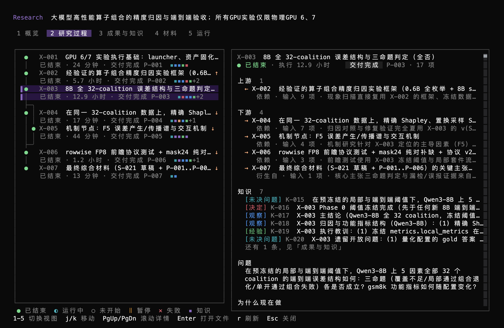
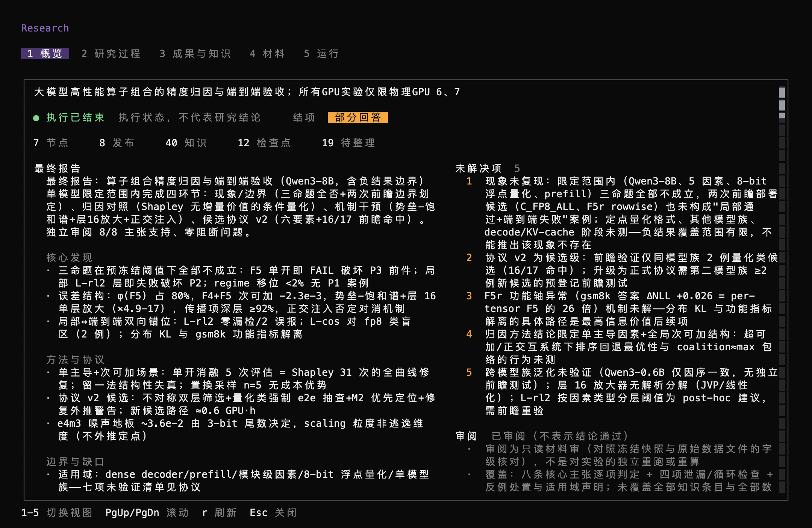
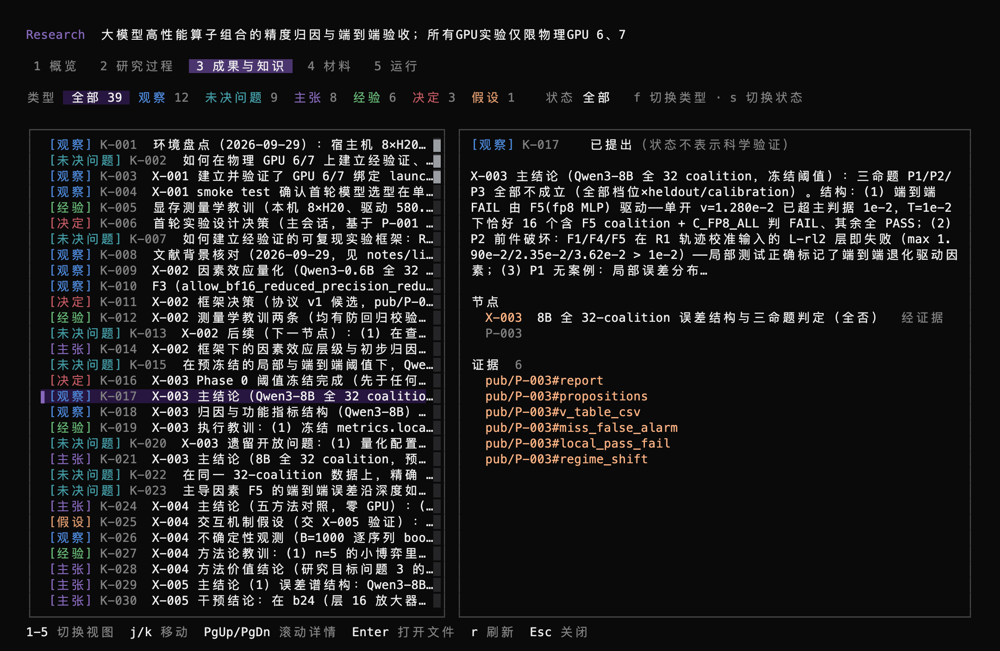
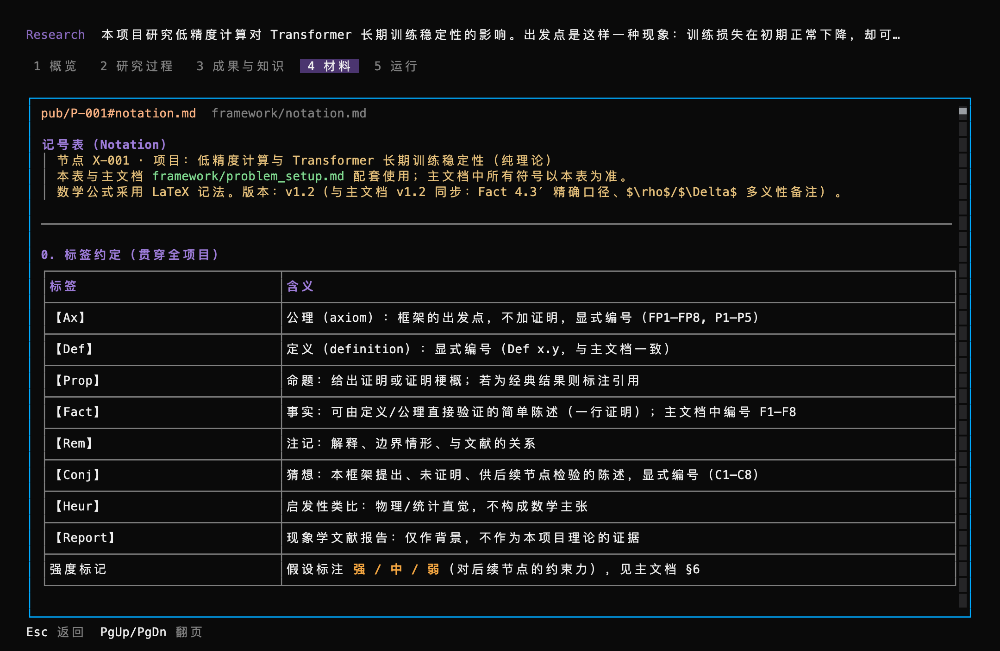

# Auto Research · OpenCode V2 自主研究插件

**当前版本：v0.1.1**（2026-09-29），实验版本。已审阅一次真实模型研究实例；本版针对该实例修复 checkpoint 归属和结项要求，并通过假宿主与真实研究记录的回归测试及独立打包启动测试，尚未完整重跑真实模型研究。版本变化见 [CHANGELOG.md](CHANGELOG.md)。

当前源码包含尚未发布的 R1／R2 和运行控制修复，数据库使用 schema 12。R2 已完成窄写工具、已交付基线 CAS、候选／审阅义务、关系与采用记录、持久自主调度预算及调用观测。验证与边界分别见 [R2 实施记录](docs/evidence/r2-runtime/README.md)和[运行控制验证记录](docs/evidence/runtime-control/README.md)；版本号尚未变更。

给出一个研究目标，插件就在 OpenCode V2 里驱动模型自己完成规划、派发、实验、综合和收尾，中间不需要你再发消息。你可以随时插话指导，也可以暂停或停止。研究中的节点、发布材料、知识和依据都记在项目目录的研究记录里，中断后能接着做，每条结论都能追到来源。

## 它能做什么

- **自主推进**：一条 `/research auto <目标>` 启动。主协调会话规划研究节点并派发出去，每个节点有自己的执行会话和工作目录；节点做完后，插件把结果交回主协调，唤醒它继续。
- **节点内专家**：节点执行会话可以叫只读专家做独立复核，也可以叫盲评专家，让它只看材料、不看结论。
- **研究记录**：节点、发布材料（内容固定，按哈希保存）、知识条目（修订追加版本）、依据关系都保存在项目的 `.research/` 里，可追踪材料变化对结论的影响。
- **随时可见**：右侧栏研究面板、输入框上方的状态条、对话里的进度记录，以及 `/research board` 全屏看板。
- **不影响其他工作**：不在研究项目里的会话，请求内容和装插件之前完全一样。

## 目录

| 路径 | 内容 |
|---|---|
| `plugin/` | OpenCode 插件（TypeScript）：推进引擎、研究工具、节点内专家、看板和状态栏。工作机制见 [plugin/README.md](plugin/README.md) |
| `src/auto_research/` | 研究记录（Python）：插件用一个私有进程调用它，负责 SQLite 和文件读写，不调用模型 |
| `tests/` | 研究记录的 Python 测试 |

## 环境要求

- OpenCode V2，最低版本 2.2.5（用 `opencode --version` 查看）；插件 SDK 仍固定为 `@opencode/plugin` 2.0.18
- Python 3.11 或更高：插件默认调用 `PATH` 里的 `python3`，也可以用插件选项另外指定
- Bun：用来安装插件依赖
- 原始宿主验证在 macOS 完成；v0.1.1 的后端、假宿主和打包回归在 Linux 上通过

## 安装

1. 取得代码：

   ```bash
   git clone https://github.com/RinshannKaihou/auto-research-opencode.git ~/work/agent-research/auto-research-opencode
   ```

2. 安装插件依赖：

   ```bash
   cd ~/work/agent-research/auto-research-opencode/plugin
   bun install
   bun run sync:python
   ```

3. 打开 OpenCode 的全局配置 `~/.config/opencode/opencode.jsonc`（或 `opencode.json`），在最外层加上插件目录的**绝对路径**：

   ```jsonc
   "plugins": ["/Users/<你>/work/agent-research/auto-research-opencode/plugin"]
   ```

   要改参数时写成带选项的形式，见下文"插件选项"。

4. **重启 OpenCode 的后台服务**：

   ```bash
   opencode service restart
   ```

   这一步不能省。OpenCode V2 的所有界面窗口共用一个一直在后台运行的服务，插件加载在这个服务里。只关掉再打开界面，服务不会重启，新插件也就不会加载。重启服务会中断其他窗口里正在进行的对话，先把它们关掉。

5. 确认装好了：

   ```bash
   opencode plugin list
   ```

   列表里有 `auto-research` 就说明配置读到了。再打开 OpenCode，输入 `/research`，会显示用法。

## 使用

### 开始一项研究

1. 在想放研究项目的目录里启动 OpenCode。研究数据会放在这个目录下的 `.research/`（研究记录）和 `workspaces/`（节点工作目录）。
2. 在界面里选好模型。插件会把开始研究时选中的模型用于主协调、所有节点和专家。
3. 在首页输入：

   ```text
   /research auto <研究目标>
   ```

   插件会建立项目、新建主会话并开始。之后不需要再发任何消息。

想完全无人值守，启动时加 `--auto`：

```bash
opencode --auto
```

不加的话，节点每次运行命令或写文件，OpenCode 都会弹出审批，自动推进会停在那里等你处理。

### 看进度

- **右侧栏研究面板**和**输入框上方的状态条**：当前角色、运行状态、暂停原因、节点和发布的数量。
- **对话里的 `【Research 自动推进】…` 记录**：每次继续下一轮、进入等待或恢复执行，都会留一行记录。
- **`/research board`**：只读的全屏看板，主导航为 `1 概览 / 2 研究 / 3 成果`。按 `v` 切换当前页的内容：研究下有研究过程／运行会话，成果下有研究发现／发布材料／依据检查。运行会话按 Enter 可打开会话。
- **节点和专家的会话**：它们都是单独的会话，标题形如"X-001 · 问题""X-001 · 专家 · 标签"。按 `Ctrl+X` 再按 `L` 打开会话列表，就能找到。

#### 看板示例

下面是一个已结束的研究项目在看板里的样子（132 列终端）。

**研究过程**：节点按依赖关系画成轨道，圆点颜色表示执行状态；选中节点的上游、下游用 ↑ / ↓ 标出。右侧先列上下游和理由，再列相关知识。



**概览**：先给执行状态和结项结果，再并排列出最终报告和未解决项。



**成果与知识**：每类知识一种颜色，筛选栏同时是图例；详情写出所属节点和证据。



**阅读器**：打开发布里的 Markdown 文件时按格式显示。



### 中途干预

| 操作 | 效果 |
|---|---|
| 在研究会话里直接打字 | 记为"用户指导"写进研究记录，模型照常读到，自动推进不停。结项后、或 `init` 之后还没开始时，打字不会写进研究记录 |
| `/research auto <补充指令>` | 已停止、已结项或刚 `init` 的项目重新开始；补充指令记为用户指导并写进启动消息，项目目标不变。研究在运行或暂停、主会话这一轮还没结束、或超过 2000 字时不接受，会提示 |
| `/research pause` | 停止新的启动授权；暂停前已获授权的节点当前轮可收尾，不再续轮 |
| `/research resume` | 显式恢复可继续的会话；重启后未核实的执行不会自动重跑 |
| `/research stop` | 请求中断运行中的会话并取消排队任务；退出未核实的执行保留待核对（需要确认） |
| `/research status` | 查看项目和本会话的状态 |
| `/research budget` | 查看持久预算、已用轮次与用量覆盖；`/research budget turns 20 原因` 显式调整限额，resume 不清账 |
| 在某个会话里按 Esc | 中断这一轮，并暂停这个会话的自动推进 |

暂停期间输入普通消息不会恢复自动推进。控制器身份、节点或专家退出、报告投递无法确认时，先查看状态和看板，独立核对原宿主及外部进程，再使用 `/research recover` 的对应命令登记核对结果；重新运行节点还需显式 `/research retry`。命令和确认条件见 [插件恢复说明](plugin/README.md#运行控制与恢复)。

其余命令（`init`、`guidance`、`takeover`、`detach`）见 [plugin/README.md](plugin/README.md#命令)。

### 节点内专家

节点执行会话需要另一个视角时，可以自己叫一位只读专家（`research_delegate`），不需要你操作：

- 专家能读节点工作目录和研究记录，不能运行命令、改文件或写研究记录，也不能再叫别人。
- 盲评专家只看得到分配给它的材料，看不到材料来源、项目目标和节点结论。
- 每个节点同时最多 2 位专家，每位最多 10 分钟。
- 专家的完整报告存进研究记录，节点自己判断采不采用。

详见 [plugin/README.md](plugin/README.md#节点内专家)。

## 插件选项

在配置里把插件写成带 `options` 的形式，每一项都可以省略：

```jsonc
"plugins": [
  {
    "package": "/Users/<你>/work/agent-research/auto-research-opencode/plugin",
    "options": {
      "concurrency": 1,
      "specialistFanout": 2,
      "specialistTimeoutMs": 600000,
      "python": "/path/to/python3"
    }
  }
]
```

| 选项 | 默认值 | 作用 |
|---|---|---|
| `concurrency` | 1 | 同时运行的节点数。大于 1 还没有充分测试 |
| `specialistFanout` | 2 | 每个节点同时最多几位专家 |
| `specialistTimeoutMs` | 600000 | 每位专家的时间上限（毫秒），超时后收回已写的部分，记为"未完成" |
| `python` | `python3` | 管理研究记录所用的 Python（3.11 或更高） |
| `registryPath` | `~/.local/share/auto-research-opencode/registry.sqlite3` | 记录"哪个会话属于哪个项目"的登记表 |

改完选项后要执行一次 `opencode service restart`。

## 更新

当前源码将研究记录升级到 **schema 12**。首次以可写存储打开旧项目时，schema 9、10、11 按顺序逐级升级，迁移前分别保存对应的 `.research/schema-9-backup.sqlite3`、`.research/schema-10-backup.sqlite3`、`.research/schema-11-backup.sqlite3`。迁移失败后的新写入会触发带后缀的新备份，保留原备份。研究会话的状态查询或恢复也可能触发可写打开，不必等到第一次科研写入。独立只读浏览（`project_read`）支持 9／10／11／12 且不迁移。旧审阅 todo 映射为目标未知的候选，旧 completed 不推定新义务完成；历史结项标签和原请求响应保持原样。

升级后不能直接用不支持 schema 12 的旧版插件写入原库。回切 Legacy 只改变读取策略，不关闭 CAS 或降数据库版本。回退代码前应停止相关服务并保留整个当前项目副本，再在副本中使用升级前备份恢复研究记录。恢复到该备份会丢失升级后的研究记录，不能将其当作无损降级。

checkpoint 默认绑定当前节点；主协调没有节点工作时才写项目级 checkpoint。已知误归属和来源不明的历史项目 checkpoint 会从自动恢复上下文中隔离，原始记录仍可查询。

`research_conclude` 现在必须填写 `summary`、`final_ref`、`outcome`、`gaps`、`review`。这是调用接口的不兼容变更，旧脚本或提示词需补齐参数。最终发布的材料须交付完成；研究本身可以部分完成或仍未解决。结果与审阅声明单独显示，执行结束不表示结论成立。完整调用示例见 [插件说明](plugin/README.md#结项要求)。

```bash
cd ~/work/agent-research/auto-research-opencode && git pull
```

如果 `plugin/package.json` 的依赖变了，再在 `plugin/` 里执行一次 `bun install`。更新后先在 `plugin/` 执行 `bun run sync:python` 刷新内置后端，最后重启后台服务：

```bash
opencode service restart
```

若本地曾生成 `plugin/python/`，更新代码后需在 `plugin/` 执行 `bun run sync:python`，刷新优先加载的内置 Python 代码。`bun pm pack` 会通过 `prepack` 自动同步；独立打包测试验证 tarball 解压后无需仓库 `src/` 即可启动。

## 当前源码的研究可信度边界

R2 修复写入契约、审阅任务生命周期和受管自动推进，不自动证明研究结论。以下工作仍待后续版本处理：

- **高优先级：研究结论的适用条件、证据依赖与最终报告审阅。** 条件可能在知识压缩中丢失，漏登记的依赖无法触发修订传播；审阅声明不能替代对每条研究结论的验证，也不能替代对反例的分析和处理。
- **高优先级：完整科学审阅与结项准入。** R2 已支持精确版本的审阅义务与报告闭合，但任务完成、科学覆盖、风险处置分开记录。完整结项 coverage 与独立性准入属于 R3。持久轮次、总节点和时限约束插件调度；外部 CPU/GPU 进程不受全局强制限额控制。
- **中高优先级：复现材料完整性。** 保存所选文件的固定版本不代表代码、环境、原始运行和模型状态已经齐全。
- **中优先级：完整成本与框架效果评估。** 原生事件提供的实际 token／cost 按来源去重采集，缺失保持未知。观测阈值不能保证全局费用硬上限，也没有用等预算真实模型对照证明研究质量提高。

## 卸载

1. 从 OpenCode 配置里删掉 `"plugins"` 中的这一项，然后执行 `opencode service restart`。做完这一步插件就完全停用了，它从来不改其他全局设置。
2. 删掉登记表（可选）。这里不存研究内容：

   ```bash
   rm -rf ~/.local/share/auto-research-opencode
   ```

3. 各研究项目目录下的 `.research/` 和 `workspaces/` 会保留，要不要删由你决定。
4. 插件建的主会话、节点会话、专家会话留在 OpenCode 的会话列表里，和普通会话一样，可以在 OpenCode 里删。

## 常见问题

**输入 `/research` 没有反应。** 先执行 `opencode service restart`，再重新打开界面。还是没有的话：
- 用 `opencode plugin list` 确认配置里有这个插件；
- 用 `opencode debug config` 确认 OpenCode 读的是你改过的那个配置文件；
- 在 `~/.local/share/opencode/log/opencode.log` 里搜 `auto-research` 看有没有报错。

**提示找不到 Python 3.11+。** 用插件选项 `python` 指定一个 3.11 以上的 Python 的完整路径。

**自动推进停住不动。** 看状态条上的暂停原因：
- "等待节点结果"：正常，节点结束后会自动唤醒；
- 停在审批上：处理审批，或者以后启动时加 `--auto`；
- "连续几轮没有写入研究记录""连续出错""你中断了这一轮"：用 `/research resume` 继续。

**在子目录里打开，不能控制研究。** 所有研究会话都归项目根目录的插件实例管理，请在项目根目录启动 OpenCode。

**日志里反复出现 `opencode.json` 格式错误。** 那是 `~/.config/opencode/` 下一个空的 `opencode.json`，和插件无关，删掉即可。

## 和 DSH 版插件的关系

这个项目来自 DSH（DeepSeek Harness）版的研究插件：[auto-research-dsh](https://github.com/RinshannKaihou/auto-research-dsh)，最终版本 **0.6.11**。

- **研究记录来自 DSH 0.6.11**：初始研究记录使用相同的 schema 9；schema 10 增加结项记录，R2 使用 schema 11，当前运行控制修复使用 schema 12。OpenCode 另有两种上下文配置、单向接管、节点会话登记和无需会话身份的只读浏览。节点问题、依赖和分支、固定引用、知识修订，以及追踪材料变化对结论影响的功能，沿用原有设计。
- **DSH 版已停止维护**：DSH 版停在 0.6.11，不再开发。两边的代码从此各自维护，新功能只进这个仓库。
- **接管 DSH 建的项目**：在项目目录里用 `/research takeover` 接管，项目必须先在 DSH 里停下。接管是**单向**的：原来的 DSH 主会话会被移出项目，之后由 OpenCode 继续。同一个项目不要同时在 DSH 和 OpenCode 里打开。

| | DSH 版 0.6.11 | OpenCode 版 v0.1 |
|---|---|---|
| 宿主与界面 | DSH 网页版，浏览器里的 Research 工作台 | OpenCode V2 终端界面，全屏看板加侧栏和状态条 |
| 开始研究 | `/research init <目标>`，再 `/research auto` | 一条 `/research auto <目标>`，在首页就能用 |
| 自主推进 | 依靠 DSH 原生的 goal 功能继续下一轮 | 插件自己的推进引擎，由 OpenCode 每轮结束的事件驱动 |
| 节点内专家 | 包装 DSH 原生 subagent，有普通和盲评两种 | 单独的只读会话，靠会话权限规则和每次请求的工具过滤保证只读，有普通和盲评两种 |
| 专家停没停 | 需要专门的核实命令 | 能关联宿主终态时收尾；未知状态保留并等待人工核实 |
| 独立讨论、从快照接手（`discuss`、`restore`） | 有 | 还没有 |
| 核实类命令 | 有 `retry`、`verify-*` 等 | 有针对控制器、任务、专家和消息交付的 `recover`，及节点 `retry` |
| 主协调的项目级整理专家 | 有 | 还没有 |
| 接管其他宿主的项目 | 没有 | `/research takeover`，可以接管 DSH 建的项目 |

## 开发

```bash
make test          # Python 测试 + 插件测试 + 类型检查
make test-python   # 只跑 Python 测试
make test-plugin   # 只跑插件测试（假宿主 + 真实 Python）
```

改完插件代码后，要执行 `opencode service restart`，正在用的 OpenCode 才会加载新代码。插件的工作机制、工具和角色见 [plugin/README.md](plugin/README.md)。

## R1 上下文读取策略

主会话执行 `/research context-policy r1`，后续模型请求使用四块上下文：当前风险、研究发现、审阅队列摘要、文书索引。`/research context-policy legacy` 切回旧策略，省略参数查看当前策略和主会话最近一次保存的注入策略。切换立即清除上下文缓存；已有回答和最终报告不会重算，已结束的项目不会重新开始。新旧项目的缺省策略仍为 legacy；默认切换须另经 M4 效果对照。

看板 `3 成果 → v 切换至依据检查` 提供可读的风险说明、适用条件和材料入口，`f` 切换当前风险／历史审阅／文书提示，`g/o/s` 选择类型／范围或节点／审阅状态，`[` / `]` 翻页，`l` 选择依据、Enter 展开。原始 JSON 仅在按 `x` 时显示。知识详情显示固定版本、当前版本、完整 scope/conditions 与已存字段检查。

看板不提供独立的上下文检查入口。`/research context-policy` 区分当前配置与最近一次保存的注入策略；完整预览、同快照对照和进程观测仅用于开发排障。保存记录不等于模型执行成功或读懂了内容。

`research_query` 的 `critical_now`、`findings`、`completed_findings` 集合可分页展开，后续请求原样传回 `cursor`。`review_todos` 和 `hints` 也支持原样传回游标，自动恢复筛选；续页时改变筛选会要求刷新。结果变化提示刷新，仅 usage 事件不影响续页。固定 `ref` 可读取完整记录；超长记录使用 `offset/limit` 分段，携带首段的 `content_sha256` 作为 `expected_digest`，避免混合不同读取状态。

R1 原提交保持 schema 10 和研究写入语义；R2 升级到 schema 11，运行控制修复进一步升级到 schema 12。R1 读取与浏览不关闭 todo、不重新计算字段检查。回放与开发验证见 [R1 实施记录](docs/evidence/r1-context/README.md)。

## 许可证

本项目采用 [Apache License 2.0](LICENSE) 授权。
