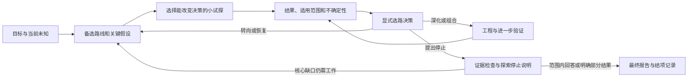

# 研究探索与多路线管理设计

更新日期：2026-11-01（Asia/Shanghai）。状态：当前主设计；E1／E2／E3 已接入开发源码，详见 [E3 详细计划](<./E3 detailed development plan auto-research-opencode.md>)及[工程记录](./evidence/e3-multiroute/README.md)。第 2 节为设计前历史审计，真实模型效果仍未验证。

**原 R1～R4 完整路线图已废止，本设计作为后续开发的语义依据。** 当前交付主线为 **E1 最小探索循环与证据读取 → E2 证据决策与结项闭合 → E3 复杂多路线管理**，不要求树搜索算法。

已完成的上下文、写入、审阅生命周期及运行控制继续作为基础。原 R3 的完整读取、风险处置、审阅覆盖与结项契约已整合进 E1/E2；原 R4 的严格确认性验证移出当前交付范围，未来按具体需求单独规划，不作为必达的第四阶段。

阶段范围见 [当前路线图](<./Remediation roadmap auto-research-opencode.md>)，具体工作包见 [当前实施计划](<./Remediation implementation plan auto-research-opencode.md>)。原始规划保存在 [历史归档](./archive/README.md)，早期开发条件分析（原始记录留在本地） 仅作为证据材料。旧计划不再决定交付顺序或充当新增需求。

## 1. 核心判断

DeepSeek 找准了主要缺口：框架能执行研究任务、保留谱系和证据，却没有持续管理“还有什么值得试、什么结果会使我改变选择、为什么现在停止”的机制。

需要增强的不是画树能力，而是四项行为：

1. 在投入大段工程工作前，识别决定路线的未知，而不是把第一份方案当成确定任务。
2. 用便宜、能区分结果的小试探降低未知；发现不支持自己的结果也算研究进展。
3. 保存尚未执行、暂缓、受挑战的路线，在新证据出现后重新选择。
4. 结束时说明目前答案受到什么证据支持，以及哪些探索没有做、为什么没有做。

**证据决策负责“据以选择和回答的证据是否可靠、限制是否保留”；探索策略负责“下一份预算花在哪里”。** 两者在重大选路和停止决策处接合。证据检查与主动生成备选共同组成研究循环，防止错误依据导致过早收敛或无效扩展。

建议第一版采用“持久路线清单 + 小额试探 + 结果后的显式决策”，随后扩展为自适应的多路线管理。先不引入 MCTS，也不强制树形、固定分叉数或反证配额。

## 2. 对 DeepSeek 分析的复核

### 2.1 数据成立，但不能超出数据解释

代码基线为 `324f2ed2ad15e88dc6ab39a50f2a3762023f8379`。实际研究库通过稳定文件副本读取；新统计保存时间为 2026-11-01 12:22:17 +08:00。原库未通过 SQLite 或 NativeStore 打开，未改运行状态。

| 保存快照 | 1031 | 1101 |
|---|---:|---:|
| 节点 | 6 | 12 |
| depends_on | 5 | 12 |
| branches_from / revises | 0 / 0 | 0 / 0 |
| strategy=continue | 6 | 12 |
| 知识条目 / 有多次 revision 的条目 | 16 / 0 | 68 / 0 |
| 知识关系 | 5 answers、3 complements | 14 answers、8 complements |
| specialist / guidance 登记 | 0 / 0 | 0 / 0 |
| 已结束且 state=finished 的节点工作段 | 5 | 10 |
| 上述工作段墙钟均值 / 中位数 | 35.20 / 22.84 分钟 | 43.23 / 41.06 分钟 |
| 结项 outcome | answered | partial |
| 保存的 context policy | memory-v2 | memory-v2 |

这些结果支持“缺少显式替代路线与修订行为”的判断，但有四个限制：

- 没有 `branches_from` 不等于节点内部没有比较。1101 的 X-001 明确比较 sync/async；1031 的 K-010 记录了多种优化尝试及无效方案。不能把所有已有研究都归为单线执行。
- 1101 的 `partial` 明确保留了主机重启导致的独立复验中断、重试未执行等缺口；不是一次无条件宣布成功。
- `open_question` 的 working 状态不是 unanswered 判据，关系条数也不能直接相减得到未回答数。某项是否已回答，需要精确关联、处置及语义核查。K-065/K-068 的确是独立复验问题，但其未完成也已进入最终 gaps。
- 43 分钟是已完成工作段的墙钟跨度，不是纯模型或实验计算成本。X-003 的 98.44 分钟、X-006 的 62.54 分钟得到核实；“用 10 分钟一定能省掉整段工作”仍是反事实假设。X-006 还产生了性能改进和有用的分布差异发现，不能整体算作浪费。

### 2.2 实现判断需要纠正的地方

| DeepSeek 的说法/建议 | 核验与修正 |
|---|---|
| branches_from 不参与调度，所以不能并行 | 不成立。两个这样的节点均可 dispatch，并发容量允许就能启动。临时后端探针已同时认领两个兄弟节点。缺的是主动选择和比较，不是分支标签解锁并行。 |
| depends_on 可以直接提供一个等待所有 scout 的汇合门 | 工具描述如此命名，但当前实现保存 scheduling 标记、校验固定材料，没有把它实现为等待前驱整个任务结束的 barrier。探针中前驱工作段仍活跃，已有冻结材料的后继可以准备并认领。比较节点应在所需结果齐备后创建，或由新决策对象显式跟踪缺失结果；不能引用尚未发布的未来材料。 |
| 没有 refuted 节点状态，因此负知识不能保存 | 过强。现有 observation/lesson/claim 可记录有范围的负结果；知识状态还支持 disputed/superseded/retracted。close_node 不删除知识或产物。真正不足是负结果没有与路线选择、重新尝试条件形成稳定联系。 |
| knowledge 只有 proposed / working | 这是两轮实际使用的状态，不是 schema 只支持这两个状态。见 `memory_store.py` 的 STATUSES。 |
| research_delegate 是现成的可执行 scout | 不成立。工具仅开放给 node_core，主协调者不能直接调用；specialist 不能执行命令。它适合读材料、质疑假设，不适合测“真实 dev 回放中谁占成本”。默认 10 分钟超时、每节点并发上限 2；不占普通节点槽不意味着不耗模型资源。 |
| guidance 能把探索变成硬约束 | 它可以影响提示，但不是后端门禁。当前按标题匹配选择 section，约 4000 字符的选择预算也不保证所有规则进入每轮上下文。 |
| 增加四项约 150 行即可实现探索 | 不足以覆盖版本化、迁移、角色授权、预算、恢复、上下文、结项和 UI。尤其不应靠改 NODE_STATES 或改变 branches_from 的依赖语义实现。 |

代码入口：`native_store.py:40,521,1224`，`memory_store.py:96,100,1684`，`plugin/src/tools.ts:385`，`plugin/src/specialists.ts:151`，`plugin/src/engine.ts:475`，`runtime_budget.py:441`，`conclusion_store.py:83`。

### 2.3 一条会影响选路的重要证据问题

1101 的 K-045、K-066、K-067 将 rare 在某种块成本口径中的约 8.7% 占比，推到“服务级 p99 改善上限约 9%”。**仅凭这个占比不能得到尾延迟上限。**

若 `f` 是同一条件下串行、可加总平均成本的占比，完全去掉该部分，平均总成本最多下降 `f`，加速比最多 `1/(1-f)`。代入 0.087 约为 1.095。这段推导不自动适用于服务 p99；它没有描述尾部条件分布、并发排队和关键路径。

因此，成本份额是安排探针的依据，不能直接作为“数学上不可能达到 p99 目标”的淘汰证据。需要统一口径的服务回放或明确的尾延迟模型。这里是本设计的数学口径检查，没有重跑原性能实验。

这也是证据检查应参与重大选路的具体例子：如果错误上限用于淘汰替代路线，更多分支也无法挽回被过早排除的方向。

## 3. 探索循环应怎样运行



### 3.1 先辨认任务性质，再决定是否扩展

- **交付型**：已给定方案的适配、修复、合并。直接执行；遇到关键未知才探索。
- **选择型**：在若干方案中选择。明确比较目标、约束和哪些结果会改变选择。
- **发现/优化型**：方向未定，或要求预算内尽量改善。先建成本/机制判断，再分配试探与深化工作。

一个项目可以包含多种任务，不能给整个项目贴一个标签后所有节点都强制发散。假设也不要求互斥：两种优化可能互补；有时真正的替代是“先保持现状、暂不优化”。

发散触发点建议包括：高代价实施前、关键假设缺证据、当前结果与预测不符、收益平台期、已有核心结论被挑战、评价场景或目标改变。合并已选实现不应自动触发三套替代实现。

生成候选时，提示模型从不同机制、实现方式、约束取舍和“现状已经足够”几个角度考虑，并说明什么观察能区分它们。“改缓存、补日志、更新文档”通常是同一方案的工作拆解，不能仅因有三个名字就算三条替代路线。重大承诺前可安排一次有界的独立质疑，重点问“哪个前提若错会改变选择”，而非要求对方一定反对；角色不同或开了新会话，也不自动证明认知独立。

### 3.2 让想法便宜，让试探有区分力

一个想法先是一张路线卡，不立即成为一个执行节点。卡片最少包含：它要回答什么、依赖哪个关键假设、什么结果会使我们改变选择、最便宜的下一步、预计成本与证据引用。

三种工作要区分：

| 工作 | 适合的问题 | 当前实现方式/改进方向 |
|---|---|---|
| 材料侦察 | 是否已经懒加载？哪项假设没有来源？有没有相反解释？ | 普通侦察节点可读仓库；节点内部可调用 read-only specialist。协调者可用自身允许的读取能力，但不把实验搬回主会话。 |
| 可执行小探针 | 成本由谁构成？两个实现哪一个可能有收益？关键反例能否重现？ | 有受限任务范围的普通 node；复用现有执行、预算和恢复路径。不能冒充只读 specialist。 |
| 工程深化 | 对已得到初步支持的方向完成实现、扩大条件、集成 | 普通 node，可包含多个后续实验，持续交回证据。 |

“5–10 分钟”可作为特定轻量任务的计划值，不能当通用保证。探针的关键是**只回答一个会影响决策的问题，并允许明确返回不支持或信息不足**。不要把完整实现、打包、所有测试和最终报告塞进每个探针。

简单的两个微基准可以在一个节点里比较，不必开两个模型会话。只有在需要独立判断、隔离改动、不同资源或并发缩短等待时再拆节点。预置轻量报告和可复用基线能减少启动与整理开销，但负结果仍需保存最小可读证据。

### 3.3 每次关键结果后，更新选择而非直接写结项报告

模型需要回答四个问题：

1. 结果改变了哪条假设、哪项收益判断或约束？
2. 当前最有希望的路线是什么，最强的未排除替代是什么？
3. 下一份小额投入为何比继续当前路线更有价值，或为何反之？
4. 选择深化、转向、组合、暂缓还是停止，依据是什么？

程序持久化这项决策并关联确切结果，不替模型断言科学真伪。没有变化的心跳不触发决策；同批结果可合并处理，避免每个 finish 都额外产生一套长表单。

“未找到反例”只描述搜索结果，不自动成为通过；“连续两轮无反例”也不是所有研究的工程准入条件。真正的准入依据应是关键风险得到足够处理、后续投入值得，而非固定轮数。

## 4. 多路线管理：路线是长期对象，节点是一次工作

最复杂的情况不是一棵很深的树，而是：多个问题各有候选，候选会共享证据、竞争资源、互相组合、因新约束被恢复。应保留 DAG 和关系，不强改成单父树。

### 4.1 对象与状态分层

| 对象 | 管什么 | 不应混同什么 |
|---|---|---|
| 决策范围 scope | 当前问题、目标、硬约束、比较条件、预算和版本 | 整个项目所有历史 open_question |
| 路线 route | 一个可长期恢复的方向、假设、基线、适用范围 | 单个 node 或一个 Git branch |
| 节点/工作段 | 具体读代码、试验、实现、比较、复核 | 科学假设的真伪 |
| 知识/证据 | 观察、主张、反例、条件和固定材料引用 | 自动路线排名 |
| 选择记录 decision | 考虑了哪些路线、选择什么、原因、未试项与恢复条件 | 当前可随手覆盖的一段 checkpoint 文本 |

一个路线可跨多个节点；一个比较节点可以评估多个路线。一个假设也可能同时影响多条路线。不要复制同一观察到所有分支后把它当成独立证据。

建议将三种状态分开：

- **执行状态**：现有 queued/running/finished/failed/cancelled/unverified 等，继续复用。
- **路线处置**：待试、已投入/深化、暂缓、排除、采用、合入组合。处置可修订，保留历史和原因。
- **假设评价**：有支持、受到反证、结果混合、信息不足；对应范围、条件、精确 evidence refs。不是把整个节点永久标为 refuted。

“程序崩溃”不是反证；“预算不够”不是路线无效；“输给 A”也不等于 B 的科学主张为假。被排除的路线必须说明排除发生在哪个目标/约束版本下。

### 4.2 最小持久化契约

先增加范围、路线、追加式决策三个领域对象；节点绑定与版本索引可以作为关联表。复用现有 knowledge、publication、review、attempt，不新造第二套知识账本。探索范围与现有审阅 scope 分开，通过选定材料和精确版本投影关联，不能让路线更新覆盖其他审阅范围。具体表名/API 留给对应工作包的接口设计确定。

```text
scope: id, revision, question_refs, objective, constraints, comparison_basis,
       parent_scope?, budget_policy, goal_version
route: id, revision, scope_id, rationale, hypothesis_refs, baseline_refs,
       disposition, reason, evidence_refs, next_probe?, reactivation_condition?
decision: id, scope_revision, considered_route_revisions, source_sequence,
          received_results, missing_results, chosen_action, rationale,
          remaining_options, budget_allocation, evidence_refs
binding: route_id, node_id, role_in_route
```

`baseline_refs` 固定工程/材料起点；`source_sequence` 表明决策看到了哪一版证据。依赖被撤回时，影响应能传播到路线选择，不只传播到最终报告。

第一版可以只有少量写入口：更新范围、维护路线、提交选择。读取复用 query/workbench。不要要求节点反复抄写全局候选表，也不要把所有未知都升级为复杂注册流程。

### 4.3 自适应分配，避免同时深化所有路线

维护两组内容：当前有预算的工作，以及未投入但仍可恢复的候选。只有选中的路线进入执行队列；候选数与并发节点数不是同一个参数。

建议的选择次序：

1. 先处理会使当前选择失效的关键缺证或反例。
2. 对剩余候选优先做便宜且有区分力的试探，复用已有结果。
3. 对结果有希望的路线追加一小段预算，不直接承诺完成整条路线。
4. 为替代方向和最终比较保留资源；可以有理由地调整分配，不把比例设成所有任务的常数。
5. 只有存在可信的可比证据或硬约束冲突才排除；噪声大、条件不同或探针失败时标为未知/暂缓。

第一版用可解释的排序与理由即可，不需要模型捏造精确“成功概率 × 收益 / 成本”分数。可以登记估计范围，但必须与实测值分列。新结果不断改变成本和判断，首轮排名不能冻结全项目。

多目标任务可能没有单一赢家。例如 A 更省内存、B 更低尾延迟，可以保留两者及适用场景，而不是偷偷换一个指标把 A 判输。随着候选变多，应合并重复想法、将同一机制归组、按需要展开局部问题；这些整理不增加执行任务。

### 4.4 异步汇合与比较

兄弟路线不共享隐式依赖门。它们可以独立返回，快的一条也不应仅因先返回就成为最终赢家。

- 在选路记录中列明预期结果、已到结果和缺失结果。
- 允许先做临时选择并继续低风险工作；最终比较必须注明缺失路线及处理理由。
- 遇到超时、环境不可用或执行状态 unverified，先按现有运行控制核实；不能把未知转成失败证据。
- 需要比较节点时，在固定输入可用后创建并引用它们；失败/未完成也可以作为明确缺失信息进入比较，但不能伪造其测量值。
- 后续迟到结果若足以改变判断，应创建新选择版本。旧决策是当时证据下的决定，不能被静默改写。

### 4.5 共享证据、比较条件与工作区

路线共享冻结基线和公共数据，各节点在自己的可写工作区试验。派发时固定输入，返回时发布冻结产物；比较和组合消费这些产物，避免直接依赖另一个尚在修改的 workspace。

性能比较至少确认：基线版本、工作负载/数据、指标定义与单位、运行环境、必要重复次数与统计口径。缺一个字段不必阻止探索，但应标为不可比或存在限制，安排校准，而不是直接排名。

两个节点并发运行不等于两份性能测量相互隔离。CPU/GPU/服务实例等共享资源可能需要执行租约或串行测量，其他分析仍可并行。目录隔离也不是强执行来源证明；本设计不授予 confirmatory 资格。

### 4.6 组合、回退和负知识复用

需要区分三个关系：工程上依赖、科学上竞争、可组合。文件没有冲突并不说明效果可以相加。

- A、B 可组合时，创建 A+B 的候选/组合工作，引用两者确切产物。
- 检查交互影响、语义一致性和约束，重新测组合效果；不把两个百分比相加。
- 如果组合破坏指标，保留 A、B 的单独结果，决定回到其中之一或继续局部试探。
- 回退是从上次有效冻结基线创建新工作，不对其他路线共享目录做破坏式 reset。
- 重试被排除路线需说明新条件：数据分布变化、约束放宽、依赖实现变化，或反证已被纠正。负结果只约束原来的适用范围，不能永久封禁路线。

### 4.7 长任务、并发与恢复的不变量

复用已实现的精确引用和 runtime control，并补以下领域约束：

- 所有全局选路由当前 main 提交；node_core 提交证据和建议，不能自行增加全局执行额度。
- 选择使用 scope/route 的 expected revision 和证据上界；新关键结果使旧决策过期时返回差异，不覆盖新状态。
- 提交选择与创建执行意图绑定幂等键；重启、重复通知、预算不足都不能重复派发。
- 暂缓/排除路线不等于已经终止其进程；需分别申请取消、核实退出、保存已产生结果。
- 保留主协调原生工具限制。探针依然由节点执行，不增加 shell 或联网绕过入口。
- 预算预留、实际使用、无法观测的使用分列。节点额度、token、墙钟、设备额度分别核算；不因“探针”改名绕过上限。
- 同一公共探针可以支持多条路线，但资源只扣一次；多路线预算分配共享全局预留账本。取消后的未用额度，只有在执行退出与使用情况核实后才能释放。
- 反复改路线说明、翻转排名或创建近似候选不自动重置 idle。探索进展须联系新增证据、实际试探或有依据的决策变化；候选整理本身也受总预算约束。
- 新一轮目标/约束变化建立新 scope revision；允许继承候选和证据，但重新校验适用性，不冒认旧结项已支持新目标。

上下文只展开当前比较和关键风险，其他路线保留可穷尽的索引、计数与游标。被暂缓路线不能因摘要截断永久消失；盲评会话仍只看被分配材料，不能把全局路线排名注入它。

## 5. 证据驱动决策与停止契约

完整依据读取与当前风险计算在 E1 提供可查询能力，让模型在大额投入、路线淘汰和最终结项时复用；E2 完成强制结项契约。小探针按决策需要使用检查，避免每次都付出全量最终审计成本。

### 5.1 完整读取与当前支撑集合

从明确的核心 claim、固定证据及最终 publication/item 取得 owner 与完整记录，展示 pinned/current 差异、scope、conditions、dependencies、evidence、checks、risk、review 和 provenance。分页和展开必须具有一致的读取边界、完整性说明及固定引用。

复用已有支撑边与影响传播，含 grounded_in 和知识版本 evidence_refs 的支撑祖先；motivated_by 不升级为失效传播边。合并当前 publication_check、字段检查、影响、处置与挑战，不只使用发布时保存的旧检查。

未覆盖引用类型、缺失依赖、遍历上限和无法检查必须进入 limitations。后端只检查已声明依据，不声称发现正文全部断言。完整交付材料也不证明模型理解了它，标题和结论强度仍需语义审阅。

### 5.2 四种结果分别表达

最终记录至少区分四件事：

| 维度 | 回答的问题 |
|---|---|
| outcome | 对当前目标回答到什么程度？ |
| evidence_closure | 已声明核心依据上的已知风险是否处理、有哪些限定？ |
| review coverage | 哪些精确版本获得了什么类型的审阅，独立性如何？ |
| exploration stop | 哪些候选被考虑，未做项为何停止/暂缓，继续工作的价值判断是什么？ |

停止可以因为目标已在声明范围内达成、已有比较足以做当前决定、下一项工作的成本不合算、资源受限或用户要求停止。不同理由不能互相替代：预算耗尽不证明没有更好路线，交付包存在不证明目标已回答。

范围内的重要替代方向需有处置，但**不要求执行全部候选或清空所有历史 open_question**。未试路线可因范围、代价或资源限制暂缓，必须保留原因、残余不确定性和恢复条件。非核心问题可带限定结项；核心证据仍不足时采用 partial/unresolved。

“预算内优化”可以诚实报告当前最好已测方案与未试范围；不能升级为全局最优。“独立复验没做”是否影响 answered，取决于目标是否要求该验证及其对核心回答的影响，不是统一归零。

新策略的后端门禁只检查：相关结果是否被处置、引用和版本是否匹配、必需范围是否完整、是否违反已声明的核心未解决状态。模型仍负责判断科学重要性。删除候选或缩小 scope 不能抹掉已知反例，必须记录原因，并让报告同步收缩主张。

用户停止、预算暂停、进程退出核实始终可以先发生，不应因探索表单没填完而阻止停止。若没有预算完成最后综合，保留未结论/部分结果和恢复入口，不自动写出 answered。

### 5.3 核心依据、覆盖与提交规则

| 情形 | 契约 |
|---|---|
| 核心已回答、已知证据问题得到处理 | 可 answered + resolved；resolved 仅描述已知问题处理情况，不证明真理 |
| 保留不影响核心回答的边界/机制缺口 | 可 answered + qualified；逐项保存 core_impact、reason、evidence_refs、disposition 和 gap |
| 未解决风险削弱核心回答或核心影响未知 | partial/unresolved，不能 answered |
| 空核心依据、覆盖不明、报告自引 | unknown；不得空集推导 reviewed/resolved；补齐结构化依据或按部分/未解决结项 |
| 仅有历史自述审阅或冻结报告 | 保留 historical/self-declared，不能升级为新派生 coverage |

未做确认性注册、执行来源未知或缺少独立审阅，本身不使探索性 answered 失格；只有其影响核心回答时才限制 outcome。

审阅精确关联 claim revision、类型、结果、实际模型、独立性和挑战处置。任务 completed 不等于风险 resolved；只读检查不能计作重新执行；任意 frozen ref 不能自动产生 reviewed。依据出错是否会改变选择及复核能否增加信息，决定使用只读 specialist 或普通可执行节点。

最终提交在同一事务里重新核验当前风险与路线决策版本，并保存有事件上界的检查快照。此前预览只是准备；之后出现的撤回、挑战或关键结果不能被旧预览跳过。报告、同源 evidence appendix 与完整读取凭据使用一致版本/哈希，变化时重新获取。缩小范围须保留理由和历史，不能抹去风险。

E1 的风险查询和停止建议不等于上述 E2 强制契约已完成。新契约启用后，旧接口或策略开关不得绕过；关闭探索策略与降级结项契约分别处理。

## 6. 一个完整的多路线例子

目标：在保持检测语义、限制内存的前提下改善真实请求延迟。以下是设计示例，不是对已有实验收益的预测。

| 路线 | 第一项区分性试探 | 可能的处置 |
|---|---|---|
| A：优化当前 Python 热路径 | 当前生产分布上成本集中在哪里，局部修改是否改变成本？ | 有收益则深化；收益低则保留当前实现作为基线 |
| B：批处理或异步化 | 减少重复开销是否引入排队、丢检测或尾部尖峰？ | 吞吐改善但违反延迟/语义约束时，在本 scope 下排除或暂缓 |
| C：原生实现 | 最小原型能否保持等价、减少主导成本，集成代价多大？ | 初步收益明显可继续；工具链不可用则记受阻，不记反证 |
| D：缩小优化范围 | 服务级代价是否已经满足用户目标？ | 若已达目标且进一步投入价值低，可选择停止优化 |

先做共享成本/环境校准，不必为 A/B/C 重复读同一份仓库。随后少量试探：A 可能最先返回正结果，但 B 的尾延迟风险仍须报告；C 若依赖 unavailable 的工具链，可以保留恢复条件；D 始终是一种合法决策。

若 A 与 B 在不同成本上互补，可测 A+B，不能直接宣布组合收益。若后续条件从低并发换成高并发，A 的优势可能不再适用，新的 scope 可重新启用 B。最终的证据检查与语义复核应发现把微基准提升写成真实服务 p99 已改善的过度概括。

这是一组可回看的研究决策：串行执行也可以做到，多个 agent 并行只是执行方式。

## 7. 当前交付结构

交付按 E1 → E2 → E3 推进，测量、兼容与效果评估贯穿全部阶段。旧 R1～R4 发布顺序不再适用；严格确认性验证没有预定的后续必达阶段。

| 切片 | 交付内容 | 主要改动面 | 完成判断 |
|---|---|---|---|
| E1：最小探索循环与证据读取 | 完整依据/风险读取；持久 scope/route/decision；关键结果触发选择；普通短节点探针；基本幂等与恢复 | schema/store、query/service、tools、context_policy、engine 通知 | 能保留备选，依据负结果转向；重大选路依据与未知可查；不宣称最终门禁已完成 |
| E2：证据决策与结项闭合 | 当前风险与范围内 exploration stop 原子校验；版本化审阅覆盖；报告/附录一致 | conclusion_store、epistemic/review_lifecycle、工具、报告和 board | 相关结果明确处置；核心未解决不能 answered；合法限定/部分结果和用户停止可表达 |
| E3：复杂多路线管理 | 多范围、多路线比较、分批预算、异步汇合、共享证据/资源、组合与恢复 | 选路领域层、runtime_budget、engine、工作区/输入、board | 多路线受共同预算约束；恢复不丢候选、不重复派发；不混用不可比结果 |
| 贯穿工作 | 方法 guidance、真实生效策略核验、观测、工程测试、等预算模型评估与策略调优 | 配置、评估、迁移、打包与宿主验证 | 证明指令/路线实际可见，评估答案质量和成本；不是最后才补效果测量 |

按风险选择只读审阅或可执行复核从 E1 复用现有能力，E2 完成其对最终 coverage 的影响。第一版不扩展 main 的 delegate 权限，也不重写 NODE_STATES。

E1/E2 可以先覆盖单个选择问题和顺序探针，就能验证主要行为；E3 处理多个范围与多条长路线的组合复杂度。E1 是跨层功能，不能按“150 行小补丁”估计；E3 的主要工作量在状态一致性、预算、比较条件与恢复，图形界面只是投影。具体工作包和依赖见当前实施计划。

### 兼容与发布

- 新对象增量迁移，旧 node/knowledge/结项含义保持；历史没有路线记录时显示 unknown/legacy，不补造探索历史。
- 初期策略可切换；旧项目必须显式采用新版范围后才执行新探索门禁，不能因历史 backlog 突然无法继续。
- 新模式的探索策略可关闭，但风险和证据历史仍保留，界面标清读取/探索/结项契约版本；已启用的新结项契约不因关闭探索而静默降级，紧急停止不依赖策略切换。
- 同步 `src/auto_research` 与插件内置 Python，覆盖 TypeScript、角色边界、迁移和宿主恢复；防止源码已改而实际插件仍跑旧包。
- 不改测量口径来宣称效果提升；强执行来源、事前注册和确认性资格属于未来独立需求。固定基线、比较条件和尝试历史是本次必需基础，保存它们不自动授予确认性资格。

## 8. 怎样验收“探索能力增加了”

分支率、反证率、修订率只作诊断，不设健康配额。任务可能本来就只有一条合理路径；强制产生 contradicts 或 revision 会诱发无意义记录，甚至不诚实的研究行为。

优先评估下列情境，保持模型、工具、环境与预算相同；运行多次，保留不成功结果和成本分布：

| 情境 | 应观察到的行为 |
|---|---|
| 初始方案很诱人但关键前提错误 | 在大额实施前找出前提，减少沉没成本或及时转向 |
| 有明确更好的替代方案 | 在预算内发现并比较，而非首个方案跑通即停止 |
| 合成分布与真实分布相反 | 校准后更新选路，保留旧结论的适用范围 |
| 只有单一合理实现、目标明确 | 正常交付，不凑三个分支 |
| 噪声、环境不一致或超时 | 保持未知/不可比，避免误剪枝 |
| 路线互补但组合发生退化 | 独立测试组合，能够恢复单独方案 |
| 负结果后新证据推翻旧判断 | 依据新条件恢复路线，不重复原封不动的死路 |
| 重启、重复通知、预算耗尽、人工停止 | 不超额或重复执行；真实退出状态与科学判断分开 |
| 核心主张后来撤回，旧结项预览已准备 | 重新读取当前依据，阻止陈旧决策提交 |

结果指标包括：关键未知是否被验证、探针是否改变了选择、最终结论质量与限定、无效深化投入、有效转向、达到目标的成本、遗漏候选与停止理由。墙钟、token、设备占用、节点启动开销分别记录；缺失用量为 unknown，不按零算。

对照建议：现有策略、新版读取、新版读取+探索提示、新版读取+证据决策检查（无新探索策略）、新版读取+证据决策检查+持久探索循环。可以分阶段做，不必一次跑满所有组合；归因时必须保留匹配对照。不能把读取切换或新检查的效果混算成探索策略贡献。严格确认性能力不参与本轮评估，避免额外混杂。

现有测试通过只证明工程契约，不证明模型更善于探索。本次没有执行这套真实模型对照，也没有证明任何节时百分比。

## 9. 核验材料与实施边界

- [匿名历史核验摘要](./evidence/exploration-20261101/public-summary.json)：保留结构统计及临时后端探针，不公开原始项目名称、研究问题或知识摘录。

设计依据核验时已完成两项临时服务探针，验证“兄弟路线可并发认领”和“depends_on 不是前驱全部结束屏障”。原始路线图替换仅修改文档；后续实现和工程验证见各阶段记录，真实模型效果仍需单独验证。
